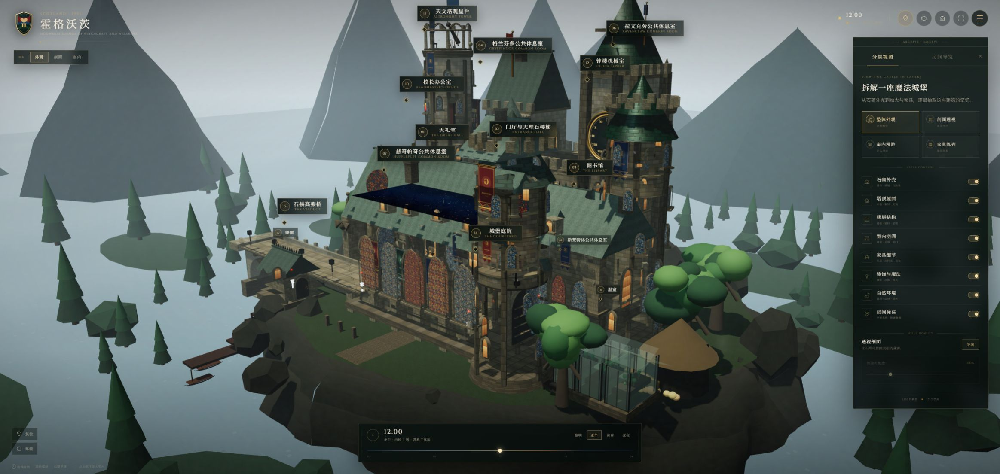

# 霍格沃茨 · 立体魔法档案

一个可以直接在浏览器中探索的霍格沃茨主题 3D 城堡。采用 Three.js，城堡几何、纹理与室内陈设在运行时生成，字体和脚本内嵌在单个 HTML 文件中。

**[在线体验 →](https://xunnia.github.io/hogwarts-castle-showcase/)**



## 可以体验什么

- 旋转、缩放和观察城堡，开启自动环绕。
- 切换整体外观、剖面透视、室内漫游与家具陈列。
- 按图层显示建筑外壳、屋顶、内部结构、家具和环境。
- 查看房间标注与房间导览。
- 调节黎明、正午、黄昏和深夜的光照，开启昼夜流转。
- 保存当前画面或进入全屏。

## 本地打开

下载仓库后，用支持 WebGL 的现代浏览器打开 `index.html`。无需安装依赖或构建。

也可以在本目录启动静态服务器：

```sh
python -m http.server 8000
```

然后访问 <http://localhost:8000>。

## 操作提示

| 操作 | 作用 |
| --- | --- |
| 鼠标拖动 / 滚轮 | 调整视角 / 缩放 |
| `Enter` | 进入城堡 |
| `Space` | 开启 / 关闭自动环绕 |
| `L` | 显示 / 隐藏房间标注 |
| `X` | 切换剖面透视 |
| `I` | 进入 / 退出室内 |
| `R` | 重置视角 |
| `N` | 切换昼夜 |
| `Esc` | 退出室内或收起面板 |

## GitHub Pages

本仓库通过 GitHub Pages 发布，使用 **main** 分支的 **/ (root)** 目录。访问上方的「在线体验」即可打开网页。

后续修改 `index.html` 并提交到 `main`，即可触发页面更新。

## 文件

- `index.html`：完整网页。
- `preview.jpg`：网页实际运行画面。
- `.nojekyll`：使用原始静态文件发布。
- `THIRD_PARTY_NOTICES.md`：Three.js 和 Cinzel 字体的来源与许可。

本项目是霍格沃茨主题的非官方爱好者可视化作品。内嵌第三方组件遵循各自许可，详见许可说明。
